<p align="center">
  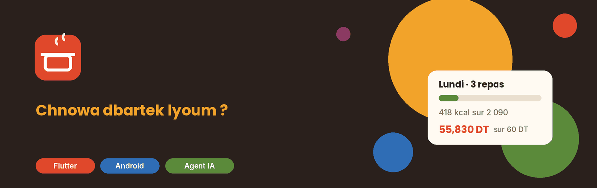
</p>

<p align="center">
  
</p>

<p align="center">
  
  
  
  
</p>

# Dbarti
> « Chnowa dbartek lyoum ? » — Qu'est-ce qu'on mange aujourd'hui ? Dbarti a déjà la réponse.

Dbarti est une application mobile Android, en français, qui prépare les repas de la semaine :

- un **questionnaire en 6 étapes** (corps, objectif, contraintes, préférences, foyer et budget, équipement) calcule le besoin en calories avec la formule de Mifflin-St Jeor ;
- un **planning de 7 jours** (21 repas) est composé par un agent IA, puis **vérifié par le code** : aucune recette avec un allergène ou un aliment exclu, et une méthode adaptée quand un appareil manque (« Sans mixeur ») ;
- chaque **recette** a ses ingrédients, ses étapes, ses valeurs caloriques, des portions ajustables et un **mode cuisine** pas à pas avec minuteur ;
- la **liste de courses** additionne les 21 repas, associe chaque ingrédient à un produit de l'enseigne et affiche le **total en dinars** (3 décimales) et le reste du budget ;
- les courses se font **en magasin** (itinéraire) ou **en livraison** sur le site de l'enseigne : la liste est copiée, le paiement se fait hors de l'application.

L'application fonctionne **sans clé ni serveur** : tout est stocké sur le téléphone.

> **Données de démonstration.** Les plats, les produits et les prix sont inventés pour la démonstration. Ils ne correspondent pas aux catalogues réels des enseignes. Cette mention figure aussi dans l'application (onglet Profil, rubrique « À propos »).


## 🧭 Le parcours

<p align="center">
  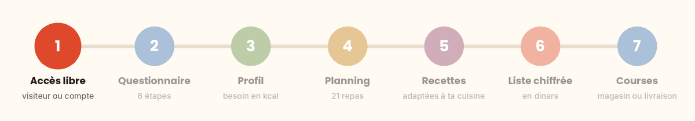
</p>

## 📱 Démonstration

<p align="center">
  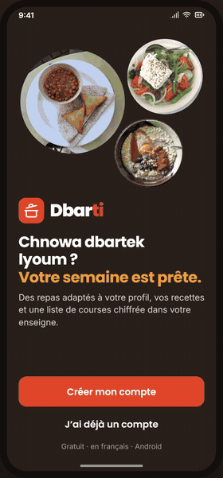
</p>

## Captures

Écrans dessinés par Flutter en 360 × 800 dp, avec le persona de démonstration (étudiante de 21 ans, 60 DT par semaine chez Carrefour, allergique aux arachides, sans four ni mixeur).

| Bienvenue (01) | Profil nutritionnel (11) | Planning (12) | Remplacer un repas (13) |
|---|---|---|---|
| 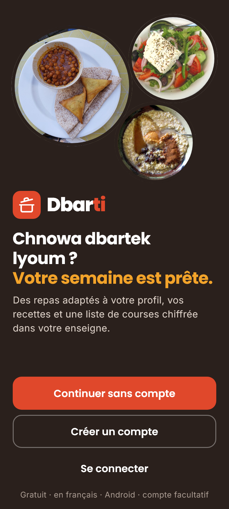 | 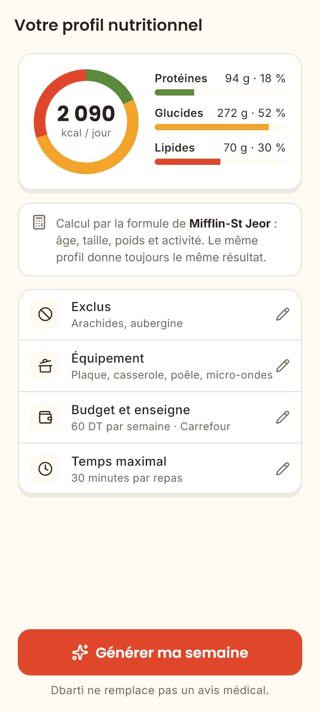 | 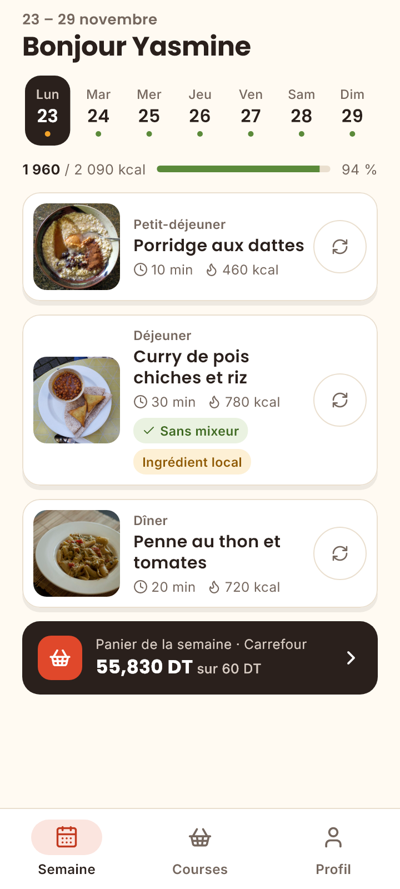 | 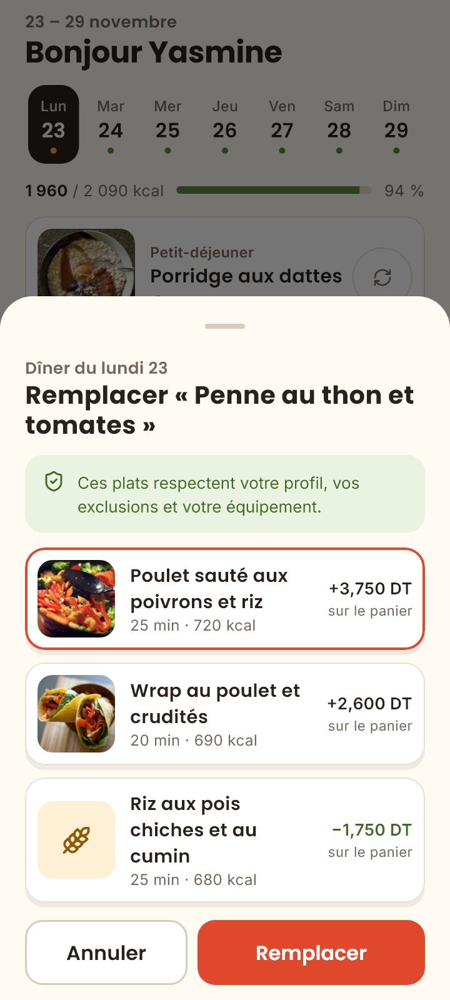 |

| Recette (14) | Mode cuisine (15) | Liste de courses (16) | Faire ses courses (17) |
|---|---|---|---|
| 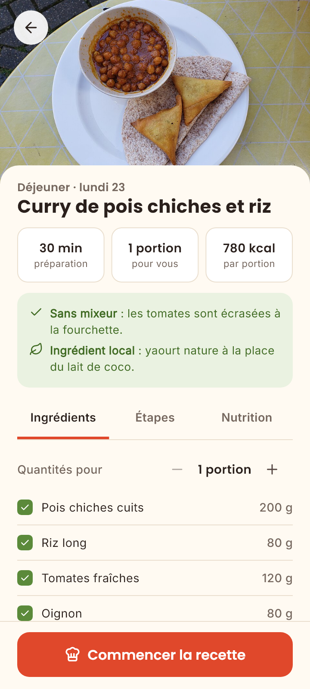 | 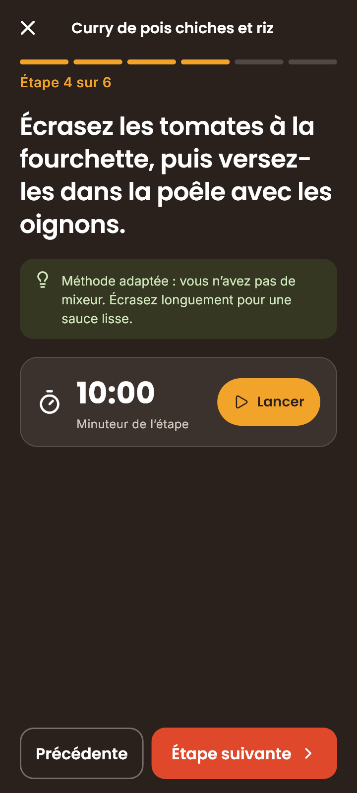 | 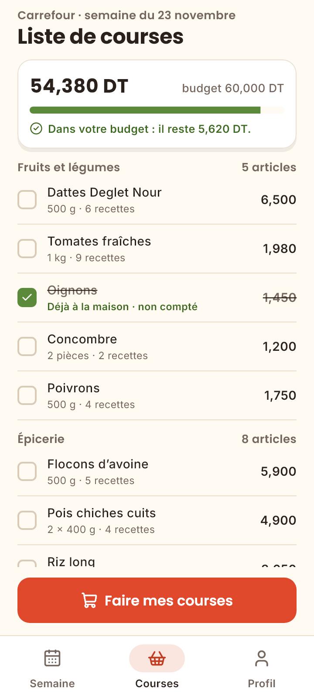 | 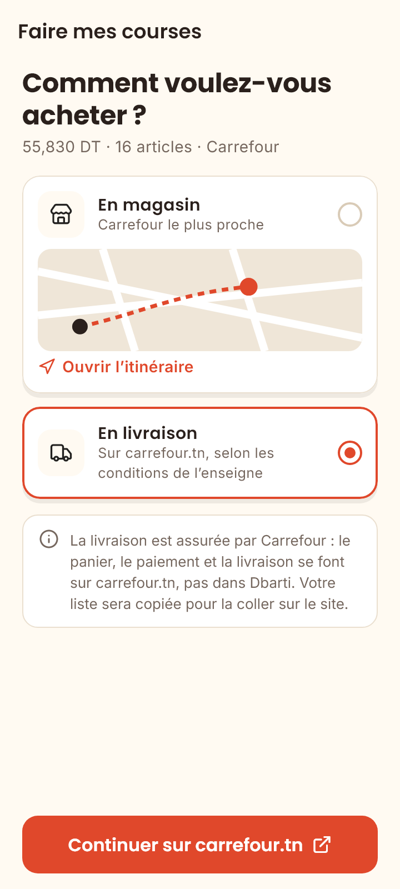 |

| Inscription, erreur (02E) | Questionnaire 1/6 (04) | Questionnaire 6/6 (09) | Profil (18) |
|---|---|---|---|
| 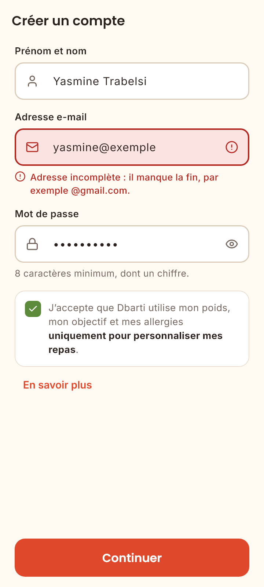 | 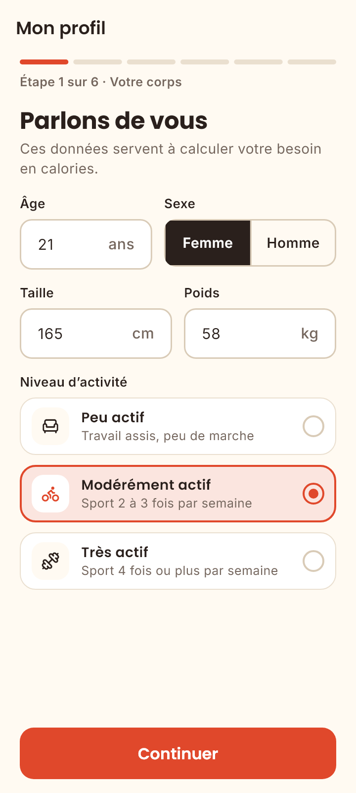 | 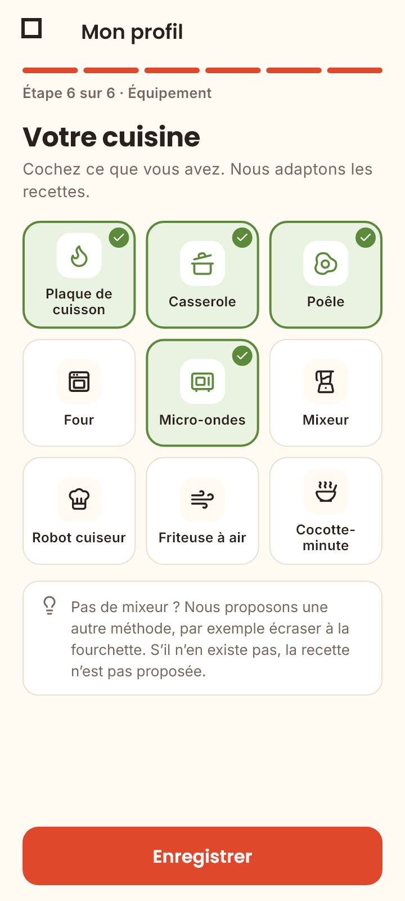 | 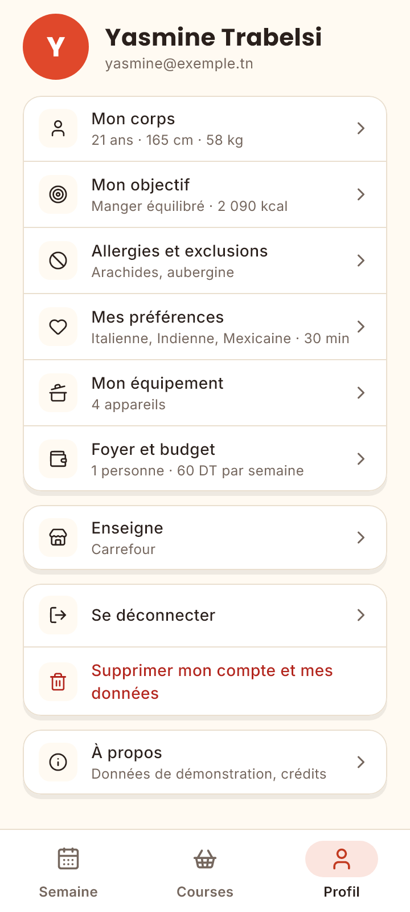 |

## Installer l'APK

1. Téléchargez `Dbarti.apk` depuis la page [Releases](../../releases/latest) du dépôt.
2. Sur le téléphone Android (7.0 ou plus récent), ouvrez le fichier et autorisez l'installation depuis cette source si Android le demande.
3. Lancez **Dbarti**, puis « Créer mon compte ».

L'APK est signé avec la clé de debug : il convient pour une démonstration, pas pour une publication sur un store.

## Lancer et tester

Prérequis : Flutter 3.47.9 (canal stable), JDK 17 et le SDK Android.

```bash
flutter pub get
flutter run                     # sur un téléphone branché en USB ou un émulateur
flutter analyze                 # analyse statique
flutter test                    # tests unitaires et tests de widget
flutter build apk --release     # APK dans build/app/outputs/flutter-apk/app-release.apk
```

Régénérer les captures de ce README :

```bash
flutter test --dart-define=CAPTURES=true --update-goldens test/captures_test.dart
```

Régénérer l'icône de l'application (depuis `assets/icone/`) :

```bash
dart run flutter_launcher_icons
```

### Agent IA facultatif

Par défaut, l'agent IA est **local** (`AgentIALocal`) : des règles et une base de connaissances (`assets/donnees/agent_ia.json`), sans réseau. Une implémentation avec l'API Claude (`AgentIAClaude`) peut être activée pour un essai en local :

```bash
flutter run --dart-define=DBARTI_CLE_IA=votre_cle
```

Une clé compilée dans un APK peut en être extraite : ne distribuez jamais un APK construit avec une clé. L'APK publié et la CI sont construits sans clé. Dans tous les cas, l'IA choisit seulement parmi les recettes de la base, et le code vérifie chaque recette (allergènes, exclusions, régime, équipement).

## Architecture

Le code suit le diagramme de classes et les 7 diagrammes de séquence du dossier de conception, avec les mêmes noms.

```
lib/
├─ modeles/      16 classes métier et 9 énumérations
├─ services/     4 contrôleurs : ServiceAuthentification, ServiceProfil, ServicePlanning, ServiceCourses
├─ externes/     3 systèmes externes (classes abstraites) : AgentIA, ServiceLivraisonEnseigne, OutilCollecte
├─ donnees/      BaseDeDonnees (Hive, local) et chargement des données de démonstration
├─ ecrans/       un fichier par écran (01 à 18, 02E, 17D), numéro en commentaire
├─ composants/   éléments réutilisés (boutons, champs, cartes)
├─ theme/        charte graphique : couleurs, Poppins et Inter
└─ main.dart
assets/donnees/  recettes, ingrédients, enseignes, catalogues (avec dateMiseAJour), agent IA, collecte simulée
```

| UML | Dart |
|---|---|
| classe | `class` |
| énumération | `enum` (valeurs en camelCase : `MICRO_ONDES` → `microOndes`) |
| «système externe» | `abstract class` + une implémentation locale |
| «contrôleur» | service `ChangeNotifier` (gestion d'état avec `provider`) |
| composition (◆) | liste possédée par l'objet (`PlanningSemaine` : exactement 21 `Repas`, vérifié) |
| association | référence vers l'autre objet |
| « − » privé | membre préfixé par `_` |

**Diagrammes** (dans [docs/diagrammes](docs/diagrammes)) :
[cas d'utilisation](docs/diagrammes/cas_utilisation.png) ·
[classes, vue d'ensemble](docs/diagrammes/classes_vue_ensemble.png) ·
[classes, diagramme complet](docs/diagrammes/diagramme_classes_complet.png) ·
[compte et profil](docs/diagrammes/classes_compte_profil.png) ·
[recettes et planning](docs/diagrammes/classes_recettes_planning.png) ·
[courses et achat](docs/diagrammes/classes_courses_achat.png) ·
[services et systèmes externes](docs/diagrammes/classes_services_externes.png)

**Séquences** :
[1 S'authentifier](docs/diagrammes/sequence_1_authentification.png) ·
[2 Questionnaire](docs/diagrammes/sequence_2_questionnaire.png) ·
[3 Générer le planning](docs/diagrammes/sequence_3_planning.png) ·
[4 Remplacer un repas](docs/diagrammes/sequence_4_remplacer_repas.png) ·
[5 Liste de courses](docs/diagrammes/sequence_5_liste_courses.png) ·
[6 Faire ses courses](docs/diagrammes/sequence_6_faire_courses.png) ·
[7 Mise à jour du catalogue](docs/diagrammes/sequence_7_catalogue.png)

### Principes

- **L'IA propose, le code vérifie.** L'agent compose les menus ; `ServicePlanning` retire toute recette qui contient un allergène, un aliment exclu ou qui ne respecte pas le régime, et la remplace. S'il manque un appareil sans méthode de remplacement, la recette est retirée.
- **Mot de passe** : jamais stocké en clair ; empreinte PBKDF2-HMAC-SHA256 avec un sel aléatoire.
- **Catalogue** : l'outil de collecte est simulé par un import JSON local (`assets/donnees/collecte/`), lancé au plus une fois par jour. Aucun scraping. Un catalogue de plus de 7 jours affiche des prix « indicatifs » (cas de Monoprix dans les données de démonstration).
- **Ergonomie** : les 8 critères de Bastien et Scapin (guidage, charge de travail, contrôle explicite, adaptabilité, gestion des erreurs, homogénéité, signifiance des codes, compatibilité), trois onglets fixes, un seul bouton principal par écran, cibles tactiles d'au moins 48 dp.

### Écarts techniques avec le diagramme de classes

Les noms du diagramme sont tous conservés. Quelques membres ont été ajoutés pour que le code fonctionne ; ils sont signalés dans le code :

- `Adaptation` : trois attributs privés facultatifs (`_ordreEtape`, `_instruction`, `_conseil`) pour afficher la consigne adaptée dans le mode cuisine ;
- `ArticleCourse._nbRecettes` : le nombre de repas qui utilisent l'ingrédient (« 1 kg · 9 recettes ») ;
- `PlanningSemaine` et `ListeCourses` gardent une référence privée vers le catalogue de l'enseigne, pour chiffrer `coutEstime()` et `generer()` ;
- les repas types (petit-déjeuner, déjeuner, dîner) sont dans la base de connaissances de l'agent, pas dans `Recette` ;
- méthodes de lecture et d'écriture JSON pour la persistance.

Les choix et les points ambigus sont détaillés dans [PLAN.md](PLAN.md).

## Tests

`flutter test` lance :

- `profil_test.dart` : `calculerBesoin()` (2 090 kcal pour le persona), facteurs d'activité, macros, limites du poids (30 à 250 kg), valeurs par défaut de l'étape Préférences ;
- `planning_test.dart` : 21 repas exactement, filtre des allergènes (arachides) et des exclusions, adaptation « Sans mixeur », recette au four retirée, coût de 55,830 DT, dépassement du budget, agent en panne (l'ancien planning reste), remplacement d'un repas ;
- `courses_test.dart` : agrégation des quantités, « à acheter ailleurs », total de 55,830 DT et reste de 4,170 DT, « déjà à la maison », prix indicatifs, collecte simulée, achat en livraison ou en magasin ;
- `authentification_test.dart` : mot de passe haché et salé, connexion, formats, suppression du compte ;
- `parcours_test.dart` (widgets) : inscription → questionnaire → analyse → profil → planning, puis liste de courses.

La CI (`.github/workflows/build-apk.yml`) lance `flutter analyze`, `flutter test` et `flutter build apk --release`, puis publie l'APK en artefact.

## Crédits

Photos des plats : Wikimedia Commons (CC0, CC BY, CC BY-SA). Polices : Poppins et Inter (SIL Open Font License). Icônes : Lucide (ISC). Le détail des sources et des licences est dans [CREDITS.md](CREDITS.md).

Projet pédagogique de développement mobile.

## 👥 L'équipe

<p align="center">
  
</p>

<p align="center">
  
  
  
  
  
</p>
